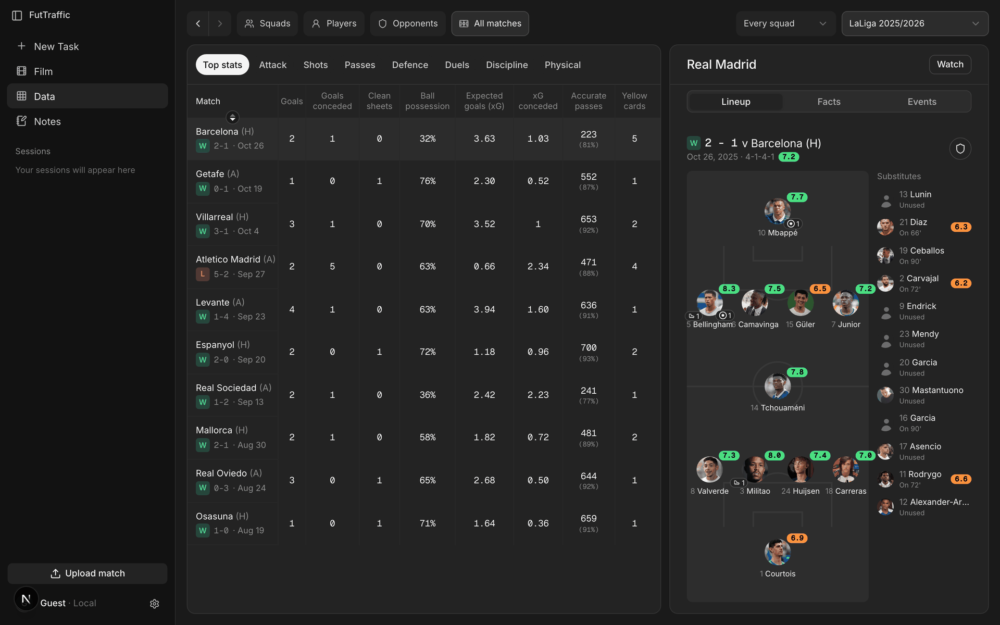
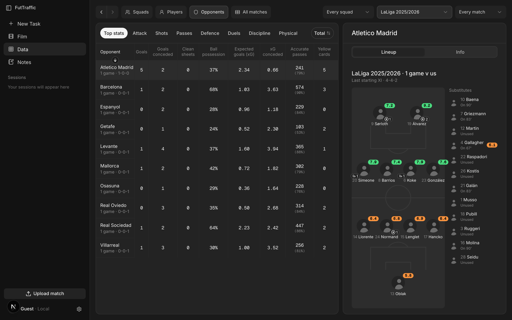

<h1> Fut Traffic</h1>

Per-player match data for grassroots football, from the one fixed panoramic camera a club already
has. Video goes in; the engine calibrates the camera to the pitch with no clicks, detects and tracks
every player and the ball, and turns the tracks into numbers for each player. A local app shows
the tracks, the numbers and the film side by side.

This is a working research codebase, not a finished product. Some stages work on the footage tested;
others do not yet. Each is described below with its measured numbers and their limits.


<sub>Zero-click calibration: the pitch model drawn through the camera fitted from the painted lines
in the footage itself. SoccerTrack v2 match 118575 (University of Tsukuba, CC BY 4.0).</sub>


<sub>Detection and tracking on the same footage: each player's box and track ID, with a ring at the
feet and the last moments of their path. Pipeline output, zoomed into the left half of the panorama.</sub>


<sub>The app's Data view, with Real Madrid's 2025/26 LaLiga fixtures imported from a public match feed
(FotMob) to show the views. These are the feed's numbers, not output of this repository's vision
pipeline; no Real Madrid video was processed. See [The app](#the-app).</sub>

## The goal

Professional clubs get tracking data from multi-camera stadium systems or GPS vests. Amateur and
youth clubs increasingly film every match on a single fixed, wide-angle rig (Veo-style cameras that
stitch two lenses into one panorama of the whole pitch), but get little data out of it beyond
the video. The end goal is to turn that one video into **the events of the match, per player**:

- **what each player did:** passes (and to whom), shots, dribbles, tackles, interceptions, crosses,
  headers, clearances and saves, each attributed to the player and placed on the pitch;
- **how each player moved:** distance, speed, high-speed running and sprints, positions and heat maps;
- **how the team played:** shape, possession, and the sequences that led to chances;
- with **no manual work**: no clicking pitch corners, no tagging, no wearables.

Events per player depend on everything underneath them: a calibrated pitch, every player found and
followed, the right identity on each track, and the ball. The stages below are those foundations,
and the table says how far each one has got. Event detection itself is not built yet.

The scope is deliberately narrow: one fixed panoramic camera that sees the whole pitch. Panning,
ball-following and broadcast cameras are out of scope, because a moving camera does not see every
player and much of what is built here assumes a camera that stays still. When a stage cannot
measure something on a given video, the app says what was not seen rather than showing a number.

## Where each stage stands

| stage | works today | not yet | read |
|---|---|---|---|
| **Calibration** (pixels to pitch metres) | Zero-click: the camera is registered to the painted lines in the match's own footage. On the install tested it cuts player-position error several-fold against a hand-clicked homography. | Shown on one camera at one ground only; a second install is needed before it can be said to generalise. Pitch width cannot be measured from this view, so it is typed in or assumed. | [n31](docs/experiments/n31-line-registration.md), [n34](docs/experiments/n34-zero-click.md), [n36](docs/experiments/n36-far-touchline.md), [n54](docs/experiments/n54-near-profile.md), [reference](docs/reference/calibration.md) |
| **Detection** (finding players) | A stock RF-DETR detector finds isolated players reliably in the near and middle of the pitch. | Partly occluded players are missed far more often, and far-side players are small. A far-field tiling pass finds more players but also the bench; its ID switches block shipping it. | [n40](docs/experiments/n40-association.md), [n43](docs/experiments/n43-far-tiles.md), [n47](docs/experiments/n47-bench.md) |
| **Tracking** (following players over time) | A C-BIoU tracker, plus a stitcher that links track fragments in pitch metres. | Tracks still break, mostly where the detector loses a player. On the one match benchmarked, most of the gap to the best published tracker is the detector, not the tracker. | [n45](docs/experiments/n45-winner-boxes.md), [n41](docs/experiments/n41-conf.md), [n42](docs/experiments/n42-merge.md), [reference](docs/reference/detection-tracking.md) |
| **Teams and identity** | Team assignment by kit colour. An operator can correct and name players, and names carry over to the club's roster. | Generic appearance models do not separate players on this footage, and jersey-number reading is unreliable at this resolution (one-digit numbers are withheld). Biometric re-identification is excluded by design. | [n49](docs/experiments/n49-jersey-ocr.md), [st2 input ledger](docs/experiments/st2-input-ledger.md), [reference](docs/reference/identity.md) |
| **Measurement** (distance, speed, sprints) | Under the zero-click map, distance and high-speed running are much closer to the truth than under a hand-clicked homography. | Both still over-read, because fragmented tracks lengthen paths; more calibration work will not move that floor. Short tracks also hide speed over-reads from a per-clip plausibility check. | [n22](docs/experiments/n22-what-inflates-distance.md), [n26](docs/experiments/n26-map-oracle.md), [n27](docs/experiments/n27-tps-in-product.md), [n28](docs/experiments/n28-plausibility.md), [reference](docs/reference/measurement.md) |
| **Ball** | The stock detector's ball class runs through a candidate picker. A cleaner, licence-safe ball detector has been trained and scored. | The new detector is not wired into the app (it costs a second detection pass), and nothing downstream reads the ball yet. Every attempt so far to improve the picker has lost. | [n52](docs/experiments/n52-clean-ball-data.md), [n55](docs/experiments/n55-picker-is-clutter-not-signal.md), [n65](docs/experiments/n65-every-ball-number-was-measured-at-384.md), [n67](docs/experiments/n67-fewer-candidates-does-not-help-the-picker.md), [reference](docs/reference/ball.md) |
| **Events** (passes, possession) | Team-level possession can be inferred from player movement alone with PathCRF (external, not included). Where an event feed exists, it can be joined to the tracks. | No event detection from video yet. Player-level outputs (who passed to whom, pass networks) are refused, because identity errors make them wrong. | [st2 input ledger](docs/experiments/st2-input-ledger.md), `model/engine/possession.py`, `model/engine/events.py` |

Withdrawn and refuted results are kept in [the claims ledger](docs/ledgers/ledger-claims.md),
together with what refuted them; untested assumptions are tracked in
[assumptions](docs/ledgers/assumptions.md).

## Benchmarks

Every number below carries a tag (see [How numbers are kept honest](#how-numbers-are-kept-honest)).
The tag lines under each table are the evidence: the command that re-measures the value, or the
source it was read from, and what was held fixed. The SoccerTrack v2 footage is real match video,
but all of it comes from **one panoramic camera at one ground**. Treat every figure as a property of
that install.

### Calibration and measurement: zero clicks vs. a hand-clicked homography

| | hand-clicked homography | zero-click |
|---|---|---|
| median player-position error, clip 118575 | 8.0 m | **2.33 m** |
| distance covered vs. the dataset's feed, median over seven clips (range) | 1.226 to 1.558 | **1.183** (1.120 to 1.221) |
| high-speed running vs. the feed, median over seven clips (range) | 1.935 to 4.213 | **1.199** (1.110 to 2.026) |

    @M 8.0,2.33 :: .venv/bin/python -c "import json;r=json.load(open('model/validation/out/stc2025/n35_e2e.json'));print(*[r[a][k] for k in ('pos_median_m',) for a in ('SHIP','AUTO')],r['SHIP']['slope']['all'],r['AUTO']['slope']['all'],r['SHIP']['distance_over_floor'],r['AUTO']['distance_over_floor'],r['SHIP']['hsr_over_floor'],r['AUTO']['hsr_over_floor'])"
       held fixed: clip 118575 (ST2 train split), the product config, stride-2 frames; n=1 per arm.
       Median metres from our own boxes' feet to the dataset feed. Rows with no IoU owner are
       excluded: 9.5% (hand-clicked) and 10.9% (zero-click). One clip, one install.
    @M 1.120,1.221,1.183,1.110,2.026,1.199,1.226,1.558,1.935,4.213 :: .venv/bin/python model/validation/n35_raw.py
       held fixed: the seven same-install ST2 clips, the product config, nothing tuned; n=1 per arm.
       Raw ratios against the feed, not over the tracking floor: zero-click distance min, max,
       median, then HSR min, max, median; then the hand-clicked distance and HSR ranges.

Caveats: the seven clips are one camera on one pitch, so they are seven samples of the players, not
seven tests of the calibration. The feed itself reads a few percent long, so "vs. the feed" is not
"vs. the truth". Distance and high-speed running still over-read, and what remains comes from
fragmented tracks, not from the map. Source: [n34, sections 7 and 8](docs/experiments/n34-zero-click.md).

### Detection recall (stock detector, as shipped)

Share of ground-truth players detected at IoU of at least 0.5, by depth third of the image. A player
counts as partly occluded when another player covers at least 35% of their box.

| | near third | middle third | far third |
|---|---|---|---|
| isolated | 0.9703 | 0.9716 | 0.8775 |
| partly occluded | 0.6846 | 0.6140 | 0.4928 |

    @M 0.9703,0.9716,0.8775,0.6846,0.6140,0.4928 :: .venv/bin/python model/validation/n40_occlusion_recall.py
       held fixed: the product's CoreML RF-DETR detections, conf 0.5, stride 2, the cached frames
       of the seven ST2 clips (one install), IoU 0.5; n=1 configuration.

Occluded players are where tracks end. Source: [n40, section 2](docs/experiments/n40-association.md).

### Tracking on SoccerTrack v2, match 128057

TrackEval, ground truth at every second frame (the product's stride). The middle row replays the
challenge winner's published detections through our unchanged tracker and stitcher. It locates the
gap; it is not something that can ship (their detector is AGPL and its weights are unpublished).

| | HOTA | DetA | AssA | IDF1 |
|---|---|---|---|---|
| this project, stock detector (as shipped) | 0.3836 | 0.6573 | 0.2242 | 0.4022 |
| our tracker on the winner's detections | 0.5149 | | | |
| the winner's full pipeline, same frames | 0.5583 | | | |

    @M 0.3836,0.6573,0.2242,0.4022,0.5149,0.5583 :: .venv/bin/python model/validation/n45_winner_boxes.py --show
       held fixed: ST2 match 128057 (one sequence of the challenge pair), the product's
       zero-click calibration and metric stitch, GT at every 2nd frame; n=1 configuration per arm,
       nothing tuned.
    @D 0.7516 :: (0.5149 - 0.3836) / (0.5583 - 0.3836)   [share of the HOTA gap closed by the winner's detections, inputs from the tag above]

On this match the detector accounts for about three quarters of the gap to the winner. One match
only. Source: [n45](docs/experiments/n45-winner-boxes.md).

### SoccerTrack Challenge 2025 leaderboard (cited)

HOTA on the challenge pair (matches 128057 and 132831). The leading entries use detectors fine-tuned
on this footage; ours is a stock detector with no dataset-specific training.

| entry | HOTA |
|---|---|
| GTATrack (wccjs, winner) | 0.60 |
| mdk-tdu | 0.59 |
| SShota | 0.59 |
| Nagoya U. (takashun, YMori) | 0.59 |
| Deep-EIoU (baseline in the winner's paper) | 0.54 |
| ByteTrack (baseline in the winner's paper) | 0.42 |
| this project, stock detector | 0.369 |

    @C 0.60,0.59 :: organisers' STC2025 leaderboard sheet, https://docs.google.com/spreadsheets/d/1ArnzG1jMJFPYElxmfwp3p1DEODKu7sIagrKgQtalz6U (gid 1845616445), rows wccjs, mdk-tdu, SShota, takashun, YMori
    @C 0.54,0.42 :: arXiv:2602.00484 (GTATrack), Table 3, Deep-EIoU and ByteTrack rows, both on the authors' fine-tuned YOLOv11x detector
    @C 0.369 :: docs/experiments/st2-input-ledger.md, STC2025 table (model/validation/st2_mot.py run of 2026-09-08, mean of 128057 and 132831, conf 0.5, no remap, no calibration, n=1)

The ByteTrack baseline is ByteTrack on the winner's fine-tuned detector, not an independent floor.
Our 0.369 is a recorded run whose tracks predate later changes, so it is cited rather than re-run;
the re-measured single-match figure is the 0.3836 above. Under our harness the winner's own answer
files score slightly below their published 0.60 ([n45](docs/experiments/n45-winner-boxes.md)).

### Ball: the new clean detector (not in the app)

Scored on six TeamTrack clips from two matches, not on SoccerTrack v2. "Ball among candidates" asks
whether any candidate in the frame is the ball; "pick is the ball" asks whether the picker chose it.
The only difference between the rows is the model's input size: earlier ball numbers in this repo
were measured at 384 px on a detector trained at 640.

| model input | ball among candidates | pick is the ball | candidates per frame |
|---|---|---|---|
| 384 px | 0.8822 | 0.4706 | 86.2 |
| 640 px (as trained) | 0.9783 | 0.5850 | 71.7 |

    @M 0.8822,0.9783,0.4706,0.5850,86.2,71.7 :: .venv/bin/python model/validation/n64_ball_negatives.py --res
       held fixed: ball_cmp.CLIPS, all six TeamTrack clips, 1800 gt-present frames, gate 20 px,
       N52 arm D1's checkpoint, tile 640 on both sides; n=1 configuration.

The ball is almost always among the candidates; choosing it is the weak step. Sources:
[n52, section 7b](docs/experiments/n52-clean-ball-data.md), [n65](docs/experiments/n65-every-ball-number-was-measured-at-384.md).

### Jersey numbers (OCR)

| | value |
|---|---|
| group precision at the shipped threshold (share of written numbers that are right) | 0.4375 |

    @M 0.4375 :: .venv/bin/python model/validation/jersey_eval.py --score
       held fixed: 118575 1st half, frames 15000-29999, jobs.apply_identity/assisted, docTR 1.1.0,
       min_conf 0.6, the job's remap calibration; n=1 configuration. Drop: 79.1% of the half's
       frames not scanned; 5 of 21 written groups have no GT player and leave precision.

This fails the project's own bar for showing a number to a user. One window of one match. Source:
[n49](docs/experiments/n49-jersey-ocr.md).

## What's next

Drawn from the "next" sections and verdicts of the experiment pages:

1. **Fine-tune the player detector on SoccerTrack v2** (RF-DETR, Apache-2.0), with officials as
   background, several seeds and a match-held-out split. It is the largest measured lever on
   tracking and on occluded and far-side players ([n45](docs/experiments/n45-winner-boxes.md)). The
   far-pass fixes are to be re-tested on the fine-tuned detector rather than tuned against today's
   boxes ([n47](docs/experiments/n47-bench.md)).
2. **A second camera install** for calibration. Every calibration result so far is one camera at one
   ground, and the open questions about the remaining error can only be settled on another
   ([n34](docs/experiments/n34-zero-click.md), [n54](docs/experiments/n54-near-profile.md)).
3. **Wire the clean ball detector** into the app at its trained input size, and give the ball a
   consumer such as possession and events ([n52](docs/experiments/n52-clean-ball-data.md),
   [ball reference](docs/reference/ball.md)).
4. **Event detection from video.** SoccerTrack v2 carries event labels for its matches, so an event
   model can be trained and scored on this footage ([st2 input ledger](docs/experiments/st2-input-ledger.md)).
   Team possession share also needs a ball-in-play signal before it can ship.
5. **Identity without biometrics.** The team gate blocks some true track joins, a larger lever than
   the stitch cost ([n40](docs/experiments/n40-association.md)); kit colour, position and
   operator-typed numbers are what remain.

## The app

A local app for one club on one machine: a FastAPI server and a Next.js UI, with no accounts.
Matches, notes and chats are stored on disk under `FUTTRAFFIC_DATA`. The sidebar has **New Task**,
**Film**, **Data**, **Notes**, **Upload match** and the saved **Sessions**.

<sub>The screenshots below show Real Madrid's 2025/26 LaLiga fixtures imported from a public match
feed (FotMob), and SoccerTrack v2 footage in the film view. Feed numbers (ratings, xG, lineups) are
the feed's own; the player positions and distances shown for the imported matches come from the
repository's motion model, not from video. None of it is a measurement of this pipeline.</sub>

### Workspace and data

- **Upload** streams the video and resumes an interrupted upload. One status banner follows the job:
  upload unfinished, needs setup, queued, finding players, matching players, ready, or stopped
  (with retry).
- **Processing** calibrates the pitch (automatically, inherited from an earlier match at the same
  ground, or clicked by hand), then tracks, identifies and measures. Results land in a local SQLite
  store that the Data views and the assistant query.
- **Data** has four views (Squads, Players, Opponents, All matches) filtered by squad, season and
  match, plus the club's ladder of squads and staff. Player profiles keep entered (feed) and
  measured (pipeline) numbers in separate blocks, with an editable bio and photo.

| | |
|---|---|
| <br><sub>Squads: season totals and the last starting XI.</sub> | <br><sub>All matches: results, with one match's lineup and ratings.</sub> |
| <br><sub>Players: the season table and a profile.</sub> | <br><sub>Opponents: one row per opponent, with their lineup.</sub> |

| | | |
|---|---|---|
| <br><sub>Film: SoccerTrack v2 match 118575 (University of Tsukuba, CC BY 4.0) with the dataset's annotated events.</sub> | <br><sub>Notes: a shot map and average positions, labelled as generated tracking.</sub> | <br><sub>Assistant: the start screen, before a question.</sub> |

### Film and video editing

- A player with a two-track timeline: **V1** is the film, **V2** your clips.
- **Events**: a searchable, filterable list of the match's events; click one to jump to it.
- **Clips**: mark in and out, save, edit, delete or copy a link; tick several and play them back to
  back as a reel.
- **Effects**: rings on tracked players, trails and a spotlight; click a player to follow them.
- **Keyboard**: play/pause, 5 and 10 s jumps, frame steps, speed, mark in/out and save, fullscreen
  (`?` lists them all).
- **Setup** for a match has a Calibrate step and an Identity step, where an operator names tracks,
  merges, splits, excludes and undoes, and the time spent is recorded.

### Notes

A club-wide library of notes in folders. Type `/` to insert a block: tables with spreadsheet
formulas, charts (bar, line, pie, scatter, and football charts such as shot maps, heat maps and
momentum), a draggable tactics board, columns, headings and lists. Charts made from match data keep
the numbers they were drawn from, can be refreshed, and say when the data behind them is generated
rather than measured. Each note is one self-contained file, so it works offline. **Export PDF**
renders it on the server (needs Playwright's Chromium). Scripts can write notes through
`app/frontend/scripts/note-api.mts`.

### Assistant

An in-app assistant that answers questions about the club's matches and acts in the workspace.
It uses the Anthropic API and **needs a key** (`ANTHROPIC_API_KEY`, or saved in Settings on this
machine); `FUTTRAFFIC_AGENT_FAKE=1` runs a scripted stand-in with no key or network.

- **Reads**: matches, match reports, player and squad stats, events, clips and video stills.
- **Acts**: opens film, data or a note beside the chat, seeks the film, creates clips and writes
  new notes. It cannot overwrite a note or change match data.
- Every number it quotes carries its confidence tier, and chats are saved as sessions that can be
  filed under a squad.
- Data stays on your machine, but the match summaries and stills the assistant reads are sent to
  Anthropic's API.

## How numbers are kept honest

Every number in the docs carries a tag. <code>&#64;M</code> means measured, with the shell command that
re-measures it. <code>&#64;C</code> means cited from an external source. <code>&#64;D</code> means derived, with the arithmetic
written out. The lines under a tag name what was held fixed: the clip, the split, the threshold.
The convention is defined in [`model/validation/verify_claims.py`](model/validation/verify_claims.py),
and the working rules behind it are in [docs/README.md](docs/README.md#working-rules):

```bash
.venv/bin/python model/validation/lint_truth.py       # mechanical checks on every doc
.venv/bin/python model/validation/verify_claims.py    # re-runs every measured tag
```

Measured tags need the dataset below, and some also need large result files from the GitHub release
(`model/validation/fetch_results.py`). Without them they fail; they do not pass.

## Data

No full match video ships with this repository; the test fixtures include a short excerpt. Download
SoccerTrack v2, then point the scripts at it:

```bash
export ST2_DIR=~/Downloads/st2          # default if unset
export FUTTRAFFIC_DATA=$PWD/data        # where the app keeps jobs
```

Small derived fixtures (calibrations, track excerpts, ball candidates) are committed under
`model/validation/` and are credited in [NOTICE](NOTICE). Some experiments describe models
trained on datasets whose terms forbid redistribution. Those weights are not included.

## Attribution

| source | licence | how it is used |
|---|---|---|
| [SoccerTrack v2](https://github.com/AtomScott/SoccerTrack-v2), Scott et al., University of Tsukuba ([arXiv:2508.01802](https://arxiv.org/abs/2508.01802)) | CC BY 4.0 | Footage, ground truth and event labels for every SoccerTrack benchmark above. Small derived fixtures (a short video excerpt, image tiles, tracks, calibrations) are committed. |
| [TeamTrack](https://github.com/AtomScott/TeamTrack), Scott et al. | MIT | Ball clips: training data for the clean ball detector and the ball benchmark. Derived fixtures are committed. |
| [ssac26 vision layer](https://github.com/USSoccerFederation/ssac26_visual_exploratory_behavior) ("Wide Open Gazes"), J. Bekkers / UnravelSports | BSD 3-Clause | Vendored in `data/vendor/ssac26/` with its licence retained. |
| [RF-DETR](https://github.com/roboflow/rf-detr), Roboflow | Apache-2.0 | The player and ball detector (nano to large only; XL and 2XL are refused at runtime). |
| [PathCRF](https://arxiv.org/abs/2602.12080), Kim et al. | MPL-2.0 | Possession from player movement (`model/engine/possession.py`). **Not included**: point `PATHCRF_DIR` at a checkout. |
| [SkillCorner open data](https://github.com/SkillCorner/opendata) | see upstream | A-League aggregates used by one experiment ([n28](docs/experiments/n28-plausibility.md)). **Not included.** |
| SoccerTrack Challenge 2025 results (organisers' leaderboard; the winner's paper, [arXiv:2602.00484](https://arxiv.org/abs/2602.00484)) | cited | The leaderboard table above. |

Dataset attributions are in [NOTICE](NOTICE). Software dependencies and model weights, with their
licence texts, are in [docs/THIRD_PARTY_NOTICES.md](docs/THIRD_PARTY_NOTICES.md).

## Layout

| path | what |
|---|---|
| `model/engine/` | calibration (`autocal.py`, `calibrators.py`, `pitch.py`), detection (`detectors.py`), tracking (`track.py`, `tracking.py`, `stitch.py`), ball (`ball.py`), measurement (`stats.py`), events (`events.py`, `possession.py`) |
| `model/validation/` | checks, harnesses, experiment scripts and the claim tooling |
| `app/server/` | the API and job worker (`app.py`, `jobs.py`) |
| `app/frontend/` | the UI (Next.js) |
| `app/desktop/` | an Electron shell that bundles both, with a synthetic demo match |
| `docs/` | write-ups; start at [docs/README.md](docs/README.md) or the generated [docs/INDEX.md](docs/INDEX.md) |

## Run

```bash
python3 -m venv .venv && .venv/bin/pip install -r app/server/requirements.txt
.venv/bin/pip install rfdetr                    # the detector: pulls torch, ~2 GB
.venv/bin/python app/server/app.py              # API, http://localhost:8000
cd app/frontend && npm install && npm run dev   # UI, http://localhost:3000
```

`rfdetr` is kept out of `requirements.txt` on purpose: every self-check and the `stub` detector
run without it, but processing a real video needs it. On a Mac, a Core ML export of the detector
is used instead when one is present (`FT_COREML_MODEL`, `FT_COREML_PYTHON`; see
`model/engine/detectors.py`).

The web app starts with an empty match list; upload a panoramic video to fill it. The desktop
build (`app/desktop/`) seeds a synthetic demo match on first run.

| variable | default | what |
|---|---|---|
| `FUTTRAFFIC_DATA` | `data/` | where the app keeps jobs, uploads and results |
| `ST2_DIR` | `~/Downloads/st2` | the SoccerTrack v2 download, for checks and experiments |
| `FUTTRAFFIC_API` | `http://127.0.0.1:8000` | where the UI finds the API |
| `ANTHROPIC_API_KEY` | unset | the in-app assistant; it can also be set in the app's settings |
| `HOST`, `PORT` | `127.0.0.1`, `8000` | where the API listens |
| `PATHCRF_DIR` | unset | a PathCRF checkout, for possession |

The API has no login. It listens on `127.0.0.1` only and refuses any request that would change
something if it comes from another website, so a page open in your browser cannot drive it. Do not
expose port 8000 to a network. To serve the UI from another host, list it in
`FUTTRAFFIC_ALLOWED_ORIGINS` and `FUTTRAFFIC_ALLOWED_HOSTS` (comma-separated).

The engine alone, on one video:

```bash
.venv/bin/python model/engine/autocal.py VIDEO   # zero-click calibration report for a panorama
.venv/bin/python model/engine/track.py VIDEO --calib calibration.json -o tracks.json
```

`track.py`'s command-line defaults are not the app's defaults. The configuration the app runs is
documented in [docs/reference/detection-tracking.md](docs/reference/detection-tracking.md#config).

## Contributors

Built by three collaborators on the original repository:

| | | |
|:---:|:---:|:---:|
| [<br>**Daniel Lopez**](https://github.com/danrublop)<br>[@danrublop](https://github.com/danrublop) | [<br>**Saikou Barry**](https://github.com/Saikou78)<br>[@Saikou78](https://github.com/Saikou78) | [<br>**Daniel Budnyatsky**](https://github.com/Daniel159642)<br>[@Daniel159642](https://github.com/Daniel159642) |

## Licence

Code: [Apache-2.0](LICENSE). Dataset attributions: [NOTICE](NOTICE). Software dependencies:
[docs/THIRD_PARTY_NOTICES.md](docs/THIRD_PARTY_NOTICES.md).
