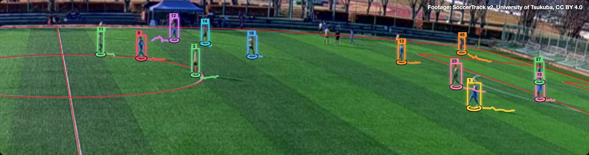
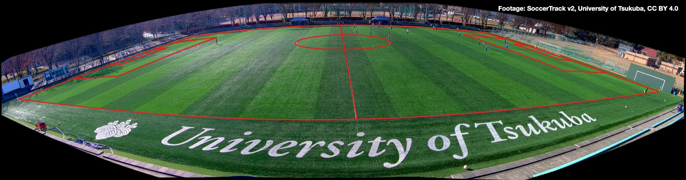
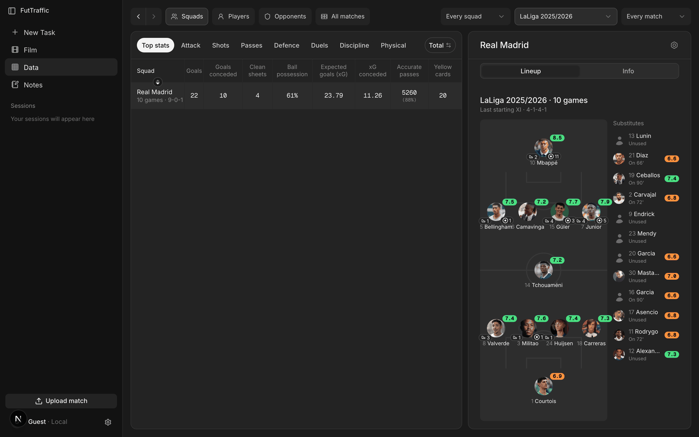
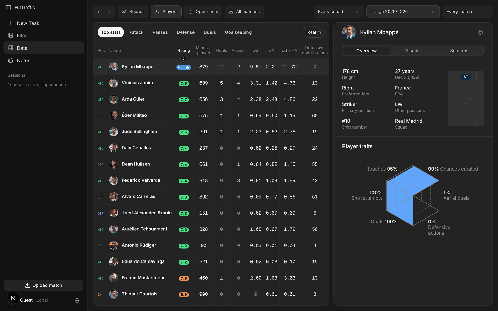
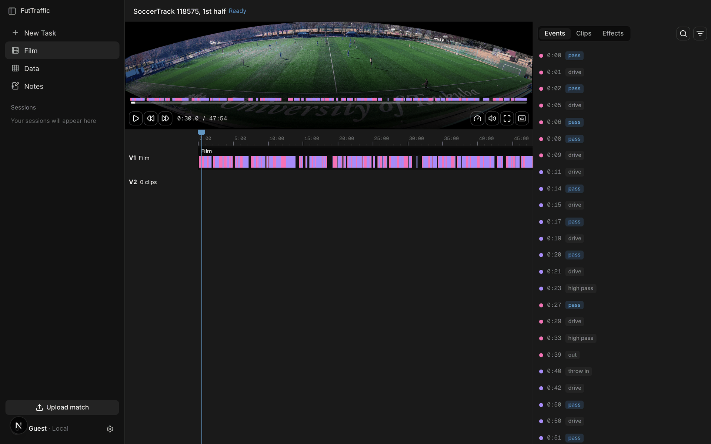
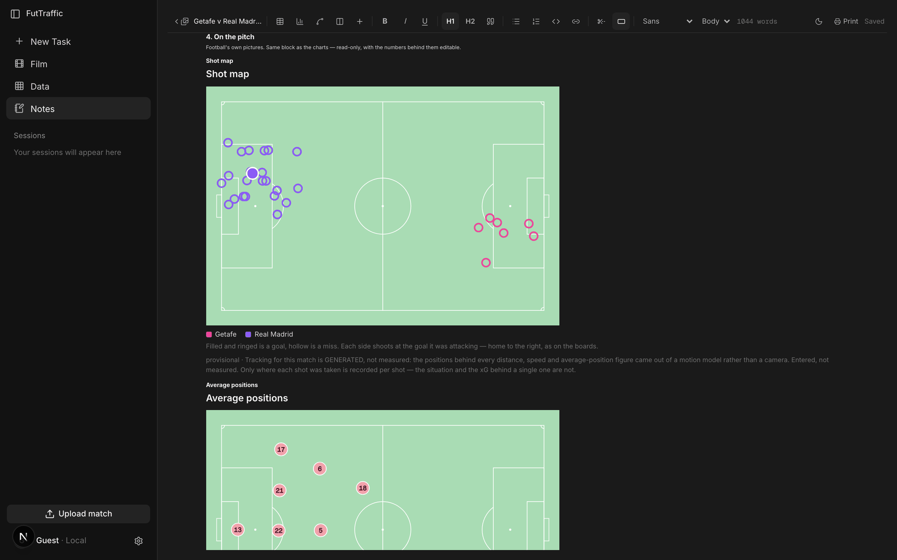
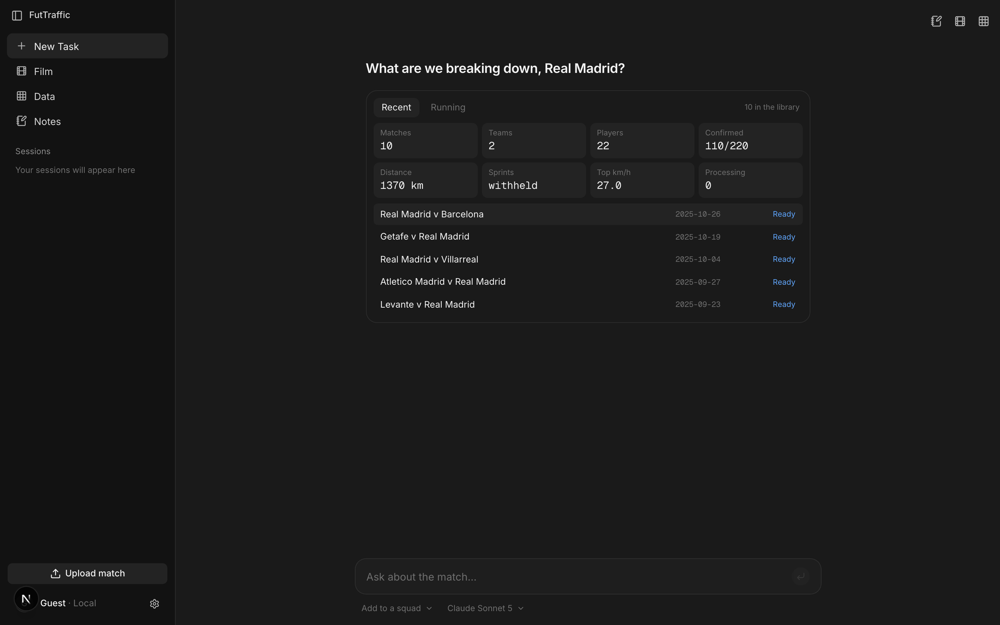

<h1 align="center">Fut Traffic</h1>

<p align="center"><b>Per-player match data for grassroots football from a single panoramic camera</b></p>

<p align="center">
  <a href="https://github.com/danrublop">Daniel Lopez</a> &nbsp;·&nbsp;
  <a href="https://github.com/Saikou78">Saikou Barry</a> &nbsp;·&nbsp;
  <a href="https://github.com/Daniel159642">Daniel Budnyatsky</a>
  <br><sub>Independent project, summer 2026</sub>
</p>

<p align="center">
  <a href="docs/benchmarks.md"></a>
  <a href="docs/README.md"></a>
  <a href="https://github.com/danrublop/futtraffic/releases/tag/results-v1"></a>
  <a href="LICENSE"></a>
</p>

<p align="center">
  <a href="https://github.com/roboflow/rf-detr"></a>
  <a href="https://arxiv.org/abs/2211.14317"></a>
</p>


<p align="center"><sub>Detection and tracking on stitched panoramic footage: every player gets a box, a track ID, a ring at the
feet and a short trail of recent positions. SoccerTrack v2 match 118575 (University of Tsukuba, CC BY 4.0).</sub></p>

<p align="center">
  <a href="https://www.linkedin.com/feed/update/urn:li:ugcPost:7516903604364943360/"></a>
</p>

**Contents:** [Abstract](#abstract) · [Problem and constraints](#1-problem-and-constraints) · [Method](#2-method) ·
[Results](#3-results) · [The app](#4-the-app) · [Limitations](#5-limitations) · [Future work](#6-future-work) ·
[Run it](#run) · [Layout](#layout) · [Data](#data) · [Honest numbers](#how-numbers-are-kept-honest) ·
[Attribution](#attribution) · [Contributors](#contributors) · [Citation](#citation)

## Abstract

Grassroots teams rarely have GPS vests or data analysts, but many film every match on a single panoramic camera.
Fut Traffic turns that video into per-player data: zero-click calibration, player and ball detection, tracking, and
distance and speed per player, in a local app. Built in one summer on a laptop and one consumer GPU, with one licensed
dataset.

## 1. Problem and constraints

The goal is the events of a match, per player: every pass, shot and tackle, attributed to the player who made it. This
repository builds the foundations (calibration, detection, tracking, identity, the ball); event detection is next.

- **Compute:** a MacBook M3 and one RTX 2060 Super.
- **Data:** SoccerTrack v2 (University of Tsukuba, CC BY 4.0), the one panoramic dataset we found with full ground truth
  and a licence that allows commercial use. One camera, one ground.

## 2. Method

```text
video ─► calibration ─► detection ─► tracking ─► teams & identity ─► measurement ─► events (next)
```

**Calibration.** The rig is modelled as one spherical camera, so every pixel is a ray to the ground. The camera is fitted
by lining a standard pitch up with the painted lines in the footage. No clicks.



**Detection.** Each frame is cut into overlapping tiles and run through RF-DETR, used as released.

**Tracking.** C-BIoU matches boxes frame to frame; a stitcher re-links broken tracks in pitch metres.

**Teams and identity.** Teams by kit colour; an operator can name, merge and split tracks.

**Ball.** A detector proposes candidates, four gates remove implausible ones (shape, static scenery, off the pitch,
wrong size), and the most confident survivor is picked.

**Measurement.** Distance, speed, high-speed running, average position and heat map per player.

## 3. Results

One camera at one ground throughout. Each table's evidence, with the command that re-measures it, is in
[docs/benchmarks.md](docs/benchmarks.md).

### 3.1 Calibration and measurement

| | hand-clicked homography | zero-click |
|---|---:|---:|
| median player-position error (clip 118575) | 8.0 m | **2.33 m** |
| distance covered vs. the dataset's feed (median of 7 clips) | 1.226–1.558× | **1.183×** |
| high-speed running vs. the feed (median of 7 clips) | 1.935–4.213× | **1.199×** |

<sub>@C 8.0,2.33,1.183,1.199,1.226,1.558,1.935,4.213 :: docs/benchmarks.md, calibration and measurement (n34).</sub>

### 3.2 Detection recall

Share of players found (IoU ≥ 0.5), by depth third of the image.

| | near | middle | far |
|---|---:|---:|---:|
| isolated | 0.9703 | 0.9716 | 0.8775 |
| partly occluded | 0.6846 | 0.6140 | 0.4928 |

<sub>@C 0.9703,0.9716,0.8775,0.6846,0.6140,0.4928 :: docs/benchmarks.md, detection recall (n40).</sub>

### 3.3 Tracking

| SoccerTrack v2 match 128057 | HOTA | DetA | AssA | IDF1 |
|---|---:|---:|---:|---:|
| **Fut Traffic, stock detector (as shipped)** | **0.3836** | **0.6573** | **0.2242** | **0.4022** |
| our tracker on the winner's detections | 0.5149 | | | |
| the winner's full pipeline, same frames | 0.5583 | | | |

<sub>@C 0.3836,0.6573,0.2242,0.4022,0.5149,0.5583 :: docs/benchmarks.md, tracking (n45).</sub>

| SoccerTrack Challenge 2025 leaderboard | HOTA |
|---|---:|
| GTATrack (winner) | 0.60 |
| mdk-tdu | 0.59 |
| SShota | 0.59 |
| Nagoya U. | 0.59 |
| Deep-EIoU (baseline in the winner's paper) | 0.54 |
| ByteTrack (baseline in the winner's paper) | 0.42 |
| **Fut Traffic, stock detector** | **0.369** |

<sub>@C 0.60,0.59,0.54,0.42,0.369 :: docs/benchmarks.md, leaderboard (organisers' sheet; arXiv:2602.00484). Leaders use fine-tuned detectors; ours is stock.</sub>

### 3.4 Ball

| new clean detector, by input size | ball among candidates | pick is the ball | candidates per frame |
|---|---:|---:|---:|
| 384 px | 0.8822 | 0.4706 | 86.2 |
| **640 px (as trained)** | **0.9783** | **0.5850** | **71.7** |

<sub>@C 0.8822,0.9783,0.4706,0.5850,86.2,71.7 :: docs/benchmarks.md, ball (n65). Six TeamTrack clips.</sub>

### 3.5 Jersey numbers

Shirt-number OCR group precision is 0.4375, too low to show users.

<sub>@C 0.4375 :: docs/benchmarks.md, jersey numbers (n49).</sub>

## 4. The app

A local app: squads and players, a film editor, notes and an AI assistant.

| | |
|---|---|
| <br><sub>**Squads:** season totals and the last starting XI.</sub> | <br><sub>**Players:** the season table and a profile.</sub> |

| | | |
|---|---|---|
| <br><sub>**Film:** two-track timeline, clips, events, player overlays.</sub> | <br><sub>**Notes:** tables with formulas, charts, pitch graphics.</sub> | <br><sub>**Assistant:** questions about the club's matches, with actions in the workspace.</sub> |

<sub>Data screenshots use Real Madrid fixtures imported from FotMob for illustration; those numbers are the feed's, not ours.</sub>

## 5. Limitations

- One camera at one ground; generalisation is unproven.
- Stock detector: partly hidden and far players are missed, which breaks tracks.
- Identity is the weakest score (AssA 0.22).
- No event detection yet.

## 6. Future work

1. Fine-tune the player detector.
2. Test calibration at more grounds.
3. Wire in the clean ball detector.
4. Detect events per player.

## Run

```bash
python3 -m venv .venv && .venv/bin/pip install -r app/server/requirements.txt
.venv/bin/pip install rfdetr                    # the detector: pulls torch, ~2 GB
.venv/bin/python app/server/app.py              # API, http://localhost:8000
cd app/frontend && npm install && npm run dev   # UI, http://localhost:3000
```

`rfdetr` is kept out of `requirements.txt` on purpose: every self-check and the `stub` detector
run without it, but processing a real video needs it. On a Mac, a Core ML export of the detector
is used instead when one is present (`FT_COREML_MODEL`, `FT_COREML_PYTHON`; see
`model/engine/detectors.py`).

The web app starts with an empty match list; upload a panoramic video to fill it. The desktop
build (`app/desktop/`) seeds a synthetic demo match on first run.

| variable | default | what |
|---|---|---|
| `FUTTRAFFIC_DATA` | `data/` | where the app keeps jobs, uploads and results |
| `ST2_DIR` | `~/Downloads/st2` | the SoccerTrack v2 download, for checks and experiments |
| `FUTTRAFFIC_API` | `http://127.0.0.1:8000` | where the UI finds the API |
| `ANTHROPIC_API_KEY` | unset | the in-app assistant; it can also be set in the app's settings |
| `HOST`, `PORT` | `127.0.0.1`, `8000` | where the API listens |
| `PATHCRF_DIR` | unset | a PathCRF checkout, for possession |

The API has no login. It listens on `127.0.0.1` only and refuses any request that would change
something if it comes from another website, so a page open in your browser cannot drive it. Do not
expose port 8000 to a network. To serve the UI from another host, list it in
`FUTTRAFFIC_ALLOWED_ORIGINS` and `FUTTRAFFIC_ALLOWED_HOSTS` (comma-separated).

The engine alone, on one video:

```bash
.venv/bin/python model/engine/autocal.py VIDEO   # zero-click calibration report for a panorama
.venv/bin/python model/engine/track.py VIDEO --calib calibration.json -o tracks.json
```

`track.py`'s command-line defaults are not the app's defaults. The configuration the app runs is
documented in [docs/reference/detection-tracking.md](docs/reference/detection-tracking.md#config).

## Layout

| path | what |
|---|---|
| `model/engine/` | calibration (`autocal.py`, `calibrators.py`, `pitch.py`), detection (`detectors.py`), tracking (`track.py`, `tracking.py`, `stitch.py`), ball (`ball.py`), measurement (`stats.py`), events (`events.py`, `possession.py`) |
| `model/validation/` | checks, harnesses, experiment scripts and the claim tooling |
| `app/server/` | the API and job worker (`app.py`, `jobs.py`) |
| `app/frontend/` | the UI (Next.js) |
| `app/desktop/` | an Electron shell that bundles both, with a synthetic demo match |
| `docs/` | write-ups; start at [docs/README.md](docs/README.md) or the generated [docs/INDEX.md](docs/INDEX.md) |

## Data

No full match video ships with this repository; the test fixtures include a short excerpt. Download
SoccerTrack v2, then point the scripts at it:

```bash
export ST2_DIR=~/Downloads/st2          # default if unset
export FUTTRAFFIC_DATA=$PWD/data        # where the app keeps jobs
```

Small derived fixtures (calibrations, track excerpts, ball candidates) are committed under
`model/validation/` and are credited in [NOTICE](NOTICE). Some experiments describe models
trained on datasets whose terms forbid redistribution. Those weights are not included.

## How numbers are kept honest

Every number in the docs carries a tag. <code>&#64;M</code> means measured, with the shell command that
re-measures it. <code>&#64;C</code> means cited from an external source. <code>&#64;D</code> means derived, with the arithmetic
written out. The lines under a tag name what was held fixed: the clip, the split, the threshold.
The convention is defined in [`model/validation/verify_claims.py`](model/validation/verify_claims.py),
and the working rules behind it are in [docs/README.md](docs/README.md#working-rules):

```bash
.venv/bin/python model/validation/lint_truth.py       # mechanical checks on every doc
.venv/bin/python model/validation/verify_claims.py    # re-runs every measured tag
```

Measured tags need the dataset below, and some also need large result files from the GitHub release
(`model/validation/fetch_results.py`). Without them they fail; they do not pass.

## Attribution

| source | licence | how it is used |
|---|---|---|
| [SoccerTrack v2](https://github.com/AtomScott/SoccerTrack-v2), Scott et al., University of Tsukuba ([arXiv:2508.01802](https://arxiv.org/abs/2508.01802)) | CC BY 4.0 | Footage, ground truth and event labels for every SoccerTrack benchmark. Small derived fixtures (a short video excerpt, image tiles, tracks, calibrations) are committed. |
| [TeamTrack](https://github.com/AtomScott/TeamTrack), Scott et al. | MIT | Ball clips: training data for the clean ball detector and the ball benchmark. Derived fixtures are committed. |
| [ssac26 vision layer](https://github.com/USSoccerFederation/ssac26_visual_exploratory_behavior) ("Wide Open Gazes"), J. Bekkers / UnravelSports | BSD 3-Clause | Vendored in `data/vendor/ssac26/` with its licence retained. |
| [RF-DETR](https://github.com/roboflow/rf-detr), Roboflow | Apache-2.0 | The player and ball detector (nano to large only; XL and 2XL are refused at runtime). |
| [PathCRF](https://arxiv.org/abs/2602.12080), Kim et al. | MPL-2.0 | Possession from player movement (`model/engine/possession.py`). **Not included**: point `PATHCRF_DIR` at a checkout. |
| [SkillCorner open data](https://github.com/SkillCorner/opendata) | see upstream | A-League aggregates used by one experiment ([n28](docs/experiments/n28-plausibility.md)). **Not included.** |
| SoccerTrack Challenge 2025 results (organisers' leaderboard; the winner's paper, [arXiv:2602.00484](https://arxiv.org/abs/2602.00484)) | cited | The leaderboard table in [docs/benchmarks.md](docs/benchmarks.md). |

Dataset attributions are in [NOTICE](NOTICE). Software dependencies and model weights, with their
licence texts, are in [docs/THIRD_PARTY_NOTICES.md](docs/THIRD_PARTY_NOTICES.md).

## Contributors


| | | |
|:---:|:---:|:---:|
| [<br>**Daniel Lopez**](https://github.com/danrublop)<br>[@danrublop](https://github.com/danrublop) | [<br>**Saikou Barry**](https://github.com/Saikou78)<br>[@Saikou78](https://github.com/Saikou78) | [<br>**Daniel Budnyatsky**](https://github.com/Daniel159642)<br>[@Daniel159642](https://github.com/Daniel159642) |

## Citation

Lopez, D., Barry, S., & Budnyatsky, D. (2026). *Fut Traffic: Per-Player Match Data from a Single Panoramic Camera.*
https://github.com/danrublop/futtraffic

```bibtex
@misc{lopez2026futtraffic,
  title        = {Fut Traffic: Per-Player Match Data from a Single Panoramic Camera},
  author       = {Lopez, Daniel and Barry, Saikou and Budnyatsky, Daniel},
  year         = {2026},
  howpublished = {\url{https://github.com/danrublop/futtraffic}},
  note         = {Open-source software, Apache-2.0}
}
```

## Licence

Code: [Apache-2.0](LICENSE). Dataset attributions: [NOTICE](NOTICE). Software dependencies:
[docs/THIRD_PARTY_NOTICES.md](docs/THIRD_PARTY_NOTICES.md).
